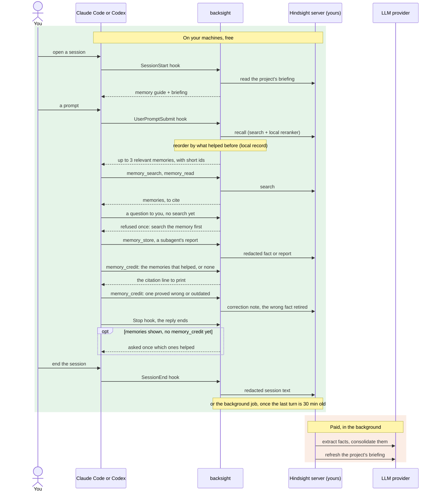
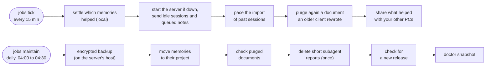

<h1>
  
  
</h1>

[](https://github.com/Barben360/backsight/actions/workflows/ci.yml?query=branch%3Amain)
[](https://github.com/Barben360/backsight/actions/workflows/gitleaks.yml?query=branch%3Amain)
[](https://github.com/Barben360/backsight/releases)
[](LICENSE)
[](go.mod)
[](docs/compatibility.md)
[](docs/compatibility.md)

Long-term memory for [Claude Code](https://code.claude.com/docs/en/overview) and [Codex](https://developers.openai.com/codex), on a [Hindsight](https://github.com/vectorize-io/hindsight) server you run yourself.

- **What**: one Go binary that installs a memory server on your machine, in [Docker](https://www.docker.com/) or natively without it (the default on Windows), wires it into Claude Code, Codex or both, and keeps it running.
- **Why**: coding agents forget everything between sessions. With backsight, Claude Code and Codex remember what you decided, fixed and learned, across all your projects, and recall it when it matters. Use both, and they share one memory.
- **Cost**: searching the memory is local and free. Only turning sessions into memories uses an LLM: a few cents per session, paid to the provider you choose ([below](#what-it-costs)).

> A *backsight* is the surveying reading taken back on a known point before moving forward.

backsight is an independent project, not affiliated with or endorsed by Anthropic, OpenAI or Vectorize.

## What it does for you

- **Remembers your sessions.** When a session ends, its text is redacted and sent to your server, which extracts durable facts: decisions, fixes, conventions, pitfalls.
- **Recalls at the right moment.** Each session starts with a briefing on the current project. Each prompt brings the few most relevant memories into the agent's context, and the agent searches the memory before answering factual questions. Every search runs on your machine, with no LLM call.
- **Works in Claude Code and Codex.** The same memory, hooks, tools and skills in both tools: what you settle in one is recalled in the other, on one PC or across your PCs.
- **Stays yours.** The server runs on your machine, on `127.0.0.1`, or on another of your machines that your other PCs also use. You choose which LLM extracts the memories, and can pause or exclude anything.
- **Looks after itself.** Daily encrypted backups, signed updates that roll back on failure, and `backsight doctor` to say what is wrong and how to fix it.

New words (bank, observation, transverse…) are in the [glossary](docs/glossary.md).

## How it compares

Coding agents can be given a memory in several ways. Compared on 2026-11-12 from each project's own docs:

| | Written by | Found by | Kept tidy by | Reaches the agent | Readable as files |
|---|---|---|---|---|---|
| `CLAUDE.md`, `AGENTS.md`, [Claude Code auto memory](https://code.claude.com/docs/en/memory) | You (`CLAUDE.md`, `AGENTS.md`), or the agent when it decides to (auto memory) | `CLAUDE.md` loaded whole; auto memory: an index loaded at start (`MEMORY.md`, first 200 lines), topic files read when needed | You, or the agent as it writes | Every session; auto memory is per repository and per machine | Yes |
| [OKF](https://github.com/GoogleCloudPlatform/knowledge-catalog/tree/main/okf) bundles, e.g. [okf-agent-memory](https://github.com/okf-memory/okf-agent-memory) | The agent, during the task, through its tools | Keyword search (BM25) | A validator for links and structure; human review in git | When the agent searches, plus a short rule file at start | Yes, in git |
| [Dreaming](https://platform.claude.com/docs/en/managed-agents/dreams) (Claude Managed Agents) | The agent, as files in a memory store | The agent reads the files | An offline pass you start through the API: merges, corrects against past transcripts | Files mounted in the session | Yes |
| [claude-mem](https://github.com/thedotmack/claude-mem) | Automatically: hooks and an LLM observer | Keyword (SQLite FTS5), optional semantic (Chroma) | No merging or contradiction handling documented | Recent observations at session start, search on demand | No (SQLite) |
| backsight, on Hindsight | Automatically: the server extracts facts when a session ends | By meaning, by keyword, through linked entities and by date, then reranked and adjusted by what helped before | Continuously: duplicates merged, contradictions kept as history, facts retired with their sources | A briefing at session start, up to 3 memories per prompt, search on demand | No (PostgreSQL) |

What sets backsight apart: memory you never have to write, found by meaning (searching "authentication" finds the note about an "expired token"), shared across all your projects and between Claude Code and Codex, and a [record of which memories helped](#how-memory-learns-what-helps) that shapes the next recall. Its defaults come from measuring what recall brought up on real sessions.

Where it is behind:

- **It needs a server.** Hindsight with PostgreSQL, in Docker or native. The file approaches need nothing but a folder.
- **It costs a few cents per session** for extraction ([below](#what-it-costs)). File approaches only use the agent's own tokens.
- **The memory is not readable as files.** You can't review it in git, and there is no export yet.
- **No trust or expiry metadata.** okf-agent-memory separates human-verified knowledge from what the agent generated, gives a fact an expiry date, and ties rules to the source files they govern. backsight does none of these.
- **Old facts are not re-checked.** Dreaming re-reads past transcripts to fix stale notes. backsight relies on the agent reporting a memory wrong or outdated when it sees one.

These gaps, and what backsight could take from these projects, are tracked in [#325](https://github.com/Barben360/backsight/issues/325).

Which to pick:

- **A few rules for one repo that rarely change:** `CLAUDE.md` or `AGENTS.md` is enough.
- **Curated project knowledge your team reviews in git:** an OKF bundle.
- **Memory that builds itself from your sessions, across many projects and both agents:** backsight. It doesn't replace your `CLAUDE.md` or `AGENTS.md`; it adds to them.

## What your coding agent gets

Setup wires Claude Code, Codex or both (it asks when it finds Codex). For Claude Code it installs a plugin, `backsight`; for Codex, two plugins, `backsight@backsight` (the memory tools and the skills) and `backsight-hooks@backsight` (the hooks alone). The binary generates all three from one source, so both tools get the same things:

| Kind | Claude Code | Codex | What it brings |
|---|---|---|---|
| Hook | `SessionStart` | `SessionStart` | The memory guide (read a linked issue first, answer in your language, never ask you for a key), the project's briefing, the status line. After `/clear`, a resume or a fork: the guide again; after a compaction: the guide, and the briefing again only if the server rewrote it. Codex runs it with your first prompt. |
| Hook | `UserPromptSubmit` | `UserPromptSubmit` | Up to 3 relevant memories added to the prompt, plus a reminder, a nudge to search, or a save prompt when one fits. |
| Hook | `PreToolUse` (`AskUserQuestion`) | `PreToolUse` (`request_user_input`) | The question gate: the agent searches the memory before asking you something it may already know. Codex 0.167.0 offers its question tool in Plan mode only. |
| Hook | `PostToolUse` (memory tools) | `PostToolUse` (memory tools) | Notes that memory was searched, for the gate and the nudge; records which memories were shown and which the agent credited. |
| Hook | `PostToolUseFailure` | — | Off by default: when a tool call fails, the pitfalls memory knows about that failure. Codex reports no failed tool call to hooks. |
| Hook | `SubagentStart`, `SubagentStop` | `SubagentStart`, `SubagentStop` | A short memory guide and the top of the briefing for each subagent; its final report kept as a note; the same end-of-turn check as `Stop`. |
| Hook | `Stop`, `SessionEnd` | `Stop`, `SessionEnd` | Marks the end of each reply (for the save detector); when memories were shown and the agent has not said which it used, asks it once to call `memory_credit`; sends the session to your server when it ends. |
| MCP tool | `memory_search` | `memory_search` | Search the memory with 1 to 4 short queries, local and free. |
| MCP tool | `memory_read` | `memory_read` | One memory with the facts it was built from. |
| MCP tool | `memory_store` | `memory_store` | Store one durable fact, redacted, and see the closest memory when it is very similar. |
| MCP tool | `memory_credit` | `memory_credit` | Name the memories shown this session that informed the answer, or that the session itself confirmed, or none (returns the citation line to print), or report one wrong or outdated: it is retired, never deleted. |
| Skill | `/backsight:remember` | `$backsight:remember` | Store a fact you give it. |
| Skill | `/backsight:pause` | `$backsight:pause` | Stop or resume recording, for the session or the project. |
| Skill | `/backsight:memory-retro` | `$backsight:memory-retro` | End-of-project retrospective: decisions, pitfalls, lessons into memory (rules into `CLAUDE.md` or `AGENTS.md`), corrections for stale ones. |
| Skill | `/backsight:memory` | `$backsight:memory` | The memory from the command line, when the MCP tools are missing or failing. |
| Skill | `/backsight:doctor` | `$backsight:doctor` | Diagnose and fix backsight, and draft a bug report you confirm. |
| Skill | `/backsight:update` | `$backsight:update` | Install a newer release from the session, once you approve its plan. |
| No prompt for the memory tools | A permission rule | The tools' own declarations | The agent calls the four memory tools without asking you each time. |

Each hook's time limit and exact behaviour: [how-it-works.md](docs/how-it-works.md#hooks). In Codex, the memory server is named `backsight`, so its tools are `mcp__backsight__memory_search` and so on; you trust the hooks once in Codex's review, and its sandbox may ask you to approve a skill's `backsight` command. Everything that differs: [docs/codex.md](docs/codex.md).

## How it works

A session and the memory, step by step. The green part runs on your machines and costs nothing; only the orange part, in the background, calls your LLM provider. The server runs on this PC, or on another of your machines that your other PCs also use ([install.md](docs/install.md#a-server-only-host)).



Background jobs keep it running (systemd user timers):



Every hook, threshold and time limit: [how-it-works.md](docs/how-it-works.md).

## How memory learns what helps


backsight counts, by id, the memories the agent was shown and the ones it reports using. A memory shown near the top and left unused is a confident miss: with one uncredited show in three counted as a miss, as drawn here, a memory credited one time in ten stays where the reranker put it, one credited more often rises and one credited less often sinks. Misses lose half their weight in 90 days and credits in a year, and the boost stays between −0.025 and +0.075 by default.

## What it costs

backsight is free, and so is searching the memory: recall at each prompt, `memory_search` and `backsight search` run on your machine, with the server's local search models, and send nothing out. The server's LLM is not free: it reads each session to extract memories, and you pay its provider for the tokens.

| Provider | Per session | Per month (5 sessions a day, 22 days) |
|---|---|---|
| DeepSeek V4.1 Flash (default) | $0.05, $0.10 at peak hours | $5, up to $11 |
| Claude Haiku 5.5 | $0.04 | $4 |
| GPT-6 Luna | $0.04 | $4 |
| [Ollama](https://ollama.com/) on your machine | free, but slow on a CPU and lower quality | free |
| Your Claude subscription | counts against your plan; [not recommended](docs/privacy.md#the-claude-subscription-lane) | |

How these figures are made, so you can redo them for your use:

- **A session** is 30,000 characters of sent text (your prompts, the agent's replies and one line per tool call): the average of 42 real sessions of the author.
- **Tokens per session**, from backsight's own estimate (the one `backsight retain backfill --plan` shows): about 92,000 input and 14,000 output tokens for extraction and consolidation. On top of that estimate, output is counted 2.5 times over for the model's thinking tokens, the ratio measured on the author's server, so these figures are higher than what `--plan` shows. Add one refresh of the project's briefing: about 96,000 input tokens on the author's average memory, up to about 130,000 on a well-filled one ([how-it-works.md](docs/how-it-works.md#time-and-context-it-costs)). A briefing is rewritten at most once every 6 hours per project, so sessions close together share one refresh.
- **Prices**, per million tokens: DeepSeek V4.1 Flash $0.15 input and $0.60 output off-peak, twice that at peak hours (01:00–04:00 and 06:00–10:00 UTC on weekdays, [DeepSeek pricing](https://api-docs.deepseek.com/quick_start/pricing/)); Claude Haiku 5.5 $0.10 input and $0.50 output ([Claude pricing](https://claude.com/pricing)); GPT-6 Luna $0.10 input and $0.50 output ([OpenAI pricing](https://developers.openai.com/api/docs/pricing)). Checked on 2026-10-26 (DeepSeek), 2026-11-01 (Claude) and 2026-11-07 (OpenAI). Cached input, which is cheaper, is counted at the full price. backsight's own estimates and cap go further for Claude and OpenAI models: input not read from the cache counts at the cache-write price, 1.25 times the input price, so they never under-count ([configuration.md](docs/configuration.md#llm-the-model-that-extracts-memories)).
- **In setup**, the providers are `deepseek` (model `deepseek-flash`, not the Pro model), `anthropic`, `openai`, `ollama` and `claude-code`. GPT-6 Luna (`gpt-6-luna`) is the default model for `openai`.

Long sessions cost more, short ones less. Importing your past sessions (backfill) is a one-off at about the same price per session: setup shows its estimate and a spending cap before you accept. `backsight stats` shows the tokens actually spent, and their cost once the model's price is known ([configuration.md](docs/configuration.md#llm-the-model-that-extracts-memories)).

Your Claude Code or Codex usage does not change, except that memories take a little of the agent's context: at most 3,000 to 4,000 tokens per session ([how-it-works.md](docs/how-it-works.md#time-and-context-it-costs)).

## Before you start

You need:

1. **Linux** on amd64, or **Windows 11** on x86_64, without administrator rights ([Windows](docs/windows.md)). macOS comes later.
2. On Linux, **Docker with Compose v2**, usable without `sudo` (Windows needs no Docker: the server runs natively):
   - install Docker Engine for your distribution: [docs.docker.com/engine/install](https://docs.docker.com/engine/install/);
   - add yourself to the `docker` group, then log out and back in: `sudo usermod -aG docker $USER` ([details](https://docs.docker.com/engine/install/linux-postinstall/)). Members of this group have root-level access to the machine; [rootless Docker](https://docs.docker.com/engine/security/rootless/) avoids that and works too;
   - check: `docker compose version` prints a version 2, without `sudo`.
3. **Claude Code** 2.1.309 or newer, with `claude` on your PATH: [install Claude Code](https://code.claude.com/docs/en/setup). Or **Codex** 0.167.0 or newer, with `codex` on your PATH, or both ([Codex](docs/codex.md)).
4. **An API key for the LLM that extracts memories**, from a pay-as-you-go account (a Claude subscription is not one):
   - DeepSeek: [platform.deepseek.com/api_keys](https://platform.deepseek.com/api_keys), then top up a few dollars. DeepSeek stores data in the People's Republic of China: read [privacy.md](docs/privacy.md#your-llm-provider) first;
   - Anthropic: [platform.claude.com/settings/keys](https://platform.claude.com/settings/keys);
   - OpenAI: [platform.openai.com/api-keys](https://platform.openai.com/api-keys);
   - or no key at all, with [Ollama](https://ollama.com/download) running on the machine.
5. About **6 GB of free disk** (the server image and its models are about 2.4 GB to download), and `curl`, `tar`, and `minisign` or OpenSSL 3 to check the release signature; on Windows, about 3.5 GB and PowerShell.

## Install

**Let your coding agent install it.** Paste this into Claude Code or any coding agent:

```text
Install Backsight for me by following https://raw.githubusercontent.com/Barben360/backsight/main/docs/agent-guide.md — ask me before every choice.
```

The agent never sees your LLM key: you type it yourself. Or install by hand:

1. Install the binary. The script checks the release's signature and checksum before installing anything:

   ```sh
   curl -fsSL https://raw.githubusercontent.com/Barben360/backsight/main/scripts/install.sh | sh
   ```

   If it prints an `export PATH=…` line, run it (or open a new login shell).

   On Windows x86_64, in PowerShell, without admin rights (the script checks the signature itself, in PowerShell; see [Windows](docs/windows.md)):

   ```powershell
   powershell -ExecutionPolicy ByPass -c "irm https://raw.githubusercontent.com/Barben360/backsight/main/scripts/install.ps1 | iex"
   ```

2. Set it up:

   ```sh
   backsight setup
   ```

   Setup checks the machine, asks a few questions (which tools to wire, when Codex is installed; the LLM provider; how long Claude Code keeps transcripts; backups; importing past sessions; importing a folder of notes; and, with Codex, whether to turn off Codex's own memories and import them), shows its plan and asks for your consent. It then asks for your provider key at a hidden prompt: keys are never passed as arguments. The first run downloads the server: several minutes on a home connection. If setup stops, fix what it says and run `backsight setup --resume`; [troubleshooting.md](docs/troubleshooting.md#setup-stopped) covers the usual causes.

3. Restart Claude Code (or run `/reload-plugins` in it). For Codex: restart it, then trust backsight's hooks in the review it shows at start ([Codex](docs/codex.md#trust-the-hooks)).

4. Another PC: install the binary the same way, then `backsight connect --token-file <file>` with the connection token the first PC hands out (`backsight server expose --private <ip> --out <file>` there, then `backsight server token --out <file>` for each new token). Carry the file yourself, never through a chat. See [several PCs](docs/several-pcs.md).

Every detail: [docs/install.md](docs/install.md).

## Check it works

1. `backsight verify` runs every hook and the memory tools as Claude Code does, then stores and recalls a test memory; `backsight verify --codex` does the same as Codex does. Setup already ran the one for each tool it wired. No line should say `fail`.
2. Start a Claude Code session in one of your projects. Its first line is `🧠 backsight · 🗂️ <project>`; the very first session also shows `👋 Memory is on`, with where sessions go. In Codex, these lines come with your first prompt.
3. `backsight doctor` checks the whole install. Right after setup, a warning that there is no backup yet is expected: the first one runs tonight, or now with `backsight backup create`.
4. Work as usual. Once your first session has ended (or sat idle for 30 minutes) and a few minutes more have passed, `backsight verify --live` confirms it reached the server and became memories, and `backsight search "<a topic of that session>"` finds them.

When the agent uses a memory, it cites it:

> 🧠 **From memory (my-project · 0b4c2a52)** — the API client retries 3 times, decided on 2026-10-12 because the gateway drops idle connections.

## Coming from another tool

Memory files from another tool ([LifeOS](https://github.com/danielmiessler/LifeOS), a notes vault, an export) or your own notes can go into the memory: `backsight import ~/notes --plan` shows the files and the cost, then `backsight import ~/notes` sends them in the background within a spending cap. [docs/import.md](docs/import.md) has the details and a LifeOS recipe.

## Pause, turn off, uninstall

| To | Run | What stays |
|---|---|---|
| Stop recording this session | `/backsight:pause` in Claude Code (`/backsight:pause resume` to go on), `$backsight:pause` in Codex | Recall keeps working. |
| Never record a project | `backsight pause --project` in its directory | Recall keeps working there. |
| Remove backsight from Codex only | `backsight client uninstall --codex` | Claude Code's wiring, your memory. |
| Undo setup | `backsight setup --undo` | backsight, your config and your memory; Claude Code and Codex are as before. |
| Remove backsight | `backsight uninstall` | Your memory server and backups. |
| Remove everything | `backsight uninstall --delete-data --purge-local` | Your backups, and the Docker images ([uninstall.md](docs/uninstall.md)). |

## Example

Monday, in a session on your `billing` project:

```text
> The invoices job times out against the new gateway. Let's raise the client timeout to 60 s and retry twice.
```

The session ends; backsight sends it to your server, which extracts the decision. On Thursday, in a new session:

```text
> Why does the invoices job take so long on failures?
```

backsight adds the memory to your prompt, and the agent answers with it:

> 🧠 **From memory (billing · 7d1e93a0)** — the invoices client timeout was raised to 60 s with 2 retries on 2026-10-12, because the new gateway is slow to answer.
>
> A failing call can take up to 3 minutes: 60 s for each of the 3 attempts.

## Privacy

- The server runs locally, on loopback, with its API and web UI behind keys, unless you open it to your other PCs on a private address (`backsight server expose --private`; a tailnet address keeps the API key encrypted, a LAN carries it in clear). Recall and searches never leave your machines. Whoever runs the host reads every PC's memories: see [several PCs](docs/several-pcs.md) and [privacy.md](docs/privacy.md#several-pcs).
- Session text goes to the LLM provider you chose, under that provider's terms. With Ollama, it stays on the machine.
- The server downloads its two search models from [Hugging Face](https://huggingface.co/) on its first start, and Docker pulls its images; no memory text goes with them.
- Secrets are redacted before anything is stored, facts that look like secrets are refused, and the agent is told never to ask you for a key in the conversation.
- `/backsight:pause` (`$backsight:pause` in Codex) stops recording a session; `backsight pause --project` or a `.backsight.toml` with `retain = false` excludes a project.
- Backups are always encrypted.
- No telemetry, no automatic reports. The binary's only other connection is a daily check for new releases on GitHub.

Details, with each provider's terms and where it keeps data: [docs/privacy.md](docs/privacy.md).

## Daily use

You mostly use Claude Code or Codex as before. Commands you may need:

| Command | Use |
|---|---|
| `backsight doctor` | Check everything, with a fix for each problem (in the session: `/backsight:doctor` or `$backsight:doctor`, which can also file a bug). |
| `backsight search "<keywords>"` | Search the memory yourself (local, free). |
| `backsight store --kind decision "<fact>"` | Store a fact (in the session: `/backsight:remember` or `$backsight:remember`). |
| `backsight forget <id>` | Retire a wrong memory. |
| `backsight pause` / `backsight resume` | Stop or restart recording (in the session: `/backsight:pause` or `$backsight:pause`). |
| `backsight stats` | See how memory was used this week, and what it cost (`--client codex` for one tool). |
| `backsight update apply` | Install a newer release, after checking its signature; you are told when one is out. |

## The dashboard

`backsight dashboard` serves a local page and prints a one-time link to it (`--open` opens it in your browser). The page answers "is my memory working?" with the numbers `backsight stats` prints, in the light or dark theme. [docs/dashboard.md](docs/dashboard.md) explains each page and each number.


## Documentation

`backsight guide` browses these docs in the terminal, and `backsight guide search "<question>"` searches them.

| Page | What is in it |
|---|---|
| [install](docs/install.md) | Requirements, setup questions, secrets, where files go. |
| [Windows](docs/windows.md) | backsight on Windows without administrator rights: install, the server's scheduled task and supervisor, updates, troubleshooting. |
| [native runtime](docs/native-runtime.md) | The server without Docker: what it is, what it lacks, how to switch. |
| [daily use](docs/daily-use.md) | Sessions, projects, skills, searching, storing, forgetting. |
| [Codex](docs/codex.md) | backsight in Codex: install, trusting the hooks, approvals, the sandbox, Codex's own memories, what differs from Claude Code. |
| [import](docs/import.md) | Importing a folder of notes or another tool's memory files, with a LifeOS recipe. |
| [GPU reranker](docs/gpu-reranker.md) | Faster recall with your NVIDIA, AMD or Intel GPU: what to install, the service to add, how to check and undo it. |
| [how it works](docs/how-it-works.md) | Recall, the question gate, the save detector, latency and context cost, the hooks. |
| [configuration](docs/configuration.md) | Every `config.toml` key. |
| [several PCs](docs/several-pcs.md) | One memory shared by your PCs: the host, joining, offline laptops, a lost laptop. |
| [privacy](docs/privacy.md) | What is stored, what leaves the machine, each provider's terms. |
| [commands](docs/commands.md) | Every command and flag. |
| [backups and restore](docs/backups-and-restore.md), [update](docs/update.md), [uninstall](docs/uninstall.md) | Keeping the install safe and current. |
| [troubleshooting](docs/troubleshooting.md) | When setup or memory stops working. |
| [dashboard](docs/dashboard.md) | The dashboard's pages and every number on them. |
| [compatibility](docs/compatibility.md) | Supported versions, and the Hindsight version each release pins. |
| [agent guide](docs/agent-guide.md) | The install steps for a coding agent. |
| [glossary](docs/glossary.md) | The words these docs use. |

## Status

backsight is stable from v1.0.0: a one-person project, used daily by its author. Linux is the main tested platform. Windows 11 x86_64 is new: CI runs its tests and a full native install, store, backup, restore and uninstall on every pull request that changes more than documentation. Codex support is new in v1.2.0: CI drives a real Codex through setup, hook trust, a session, recall, credit, update and uninstall against a scripted model on every such pull request, and a test bench shares one memory between Claude Code on one PC and Codex on another; daily use with a real model is still young. Each release pins one Hindsight version, listed in [docs/compatibility.md](docs/compatibility.md).

Found a problem? Ask your agent: `/backsight:doctor` in Claude Code, `$backsight:doctor` in Codex. It diagnoses, fixes with your OK, and drafts the issue it files only once you confirm. Or run `backsight report` yourself: it prints a redacted diagnostic and a link to file a GitHub issue, and sends nothing itself. For a security problem, see [SECURITY.md](SECURITY.md).

Contributing: [CONTRIBUTING.md](CONTRIBUTING.md).

## Third-party components

backsight does not ship these: Docker pulls the images from their publishers, and the server downloads the models from Hugging Face. They come under their own licences and terms, which you accept by installing them: check them against your use, at work in particular.

| Component | Licence | Notes |
|---|---|---|
| [Hindsight](https://github.com/vectorize-io/hindsight) server image, by Vectorize | [MIT](https://github.com/vectorize-io/hindsight/blob/main/LICENSE) | The memory server. |
| [pgvector](https://github.com/pgvector/pgvector) image (PostgreSQL with pgvector) | [PostgreSQL License](https://github.com/pgvector/pgvector/blob/master/LICENSE) | The server's database. |
| [multilingual-e5-small](https://huggingface.co/intfloat/multilingual-e5-small), the embedding model | MIT | Downloaded at the server's first start. |
| [mmarco-mMiniLMv2-L12-H384-v1](https://huggingface.co/cross-encoder/mmarco-mMiniLMv2-L12-H384-v1), the reranker | Apache-2.0 | Downloaded at the server's first start. It was trained on mMARCO, a translation of [MS MARCO](https://microsoft.github.io/msmarco/), whose terms say the data is "intended for non-commercial research purposes only". Whether those terms reach a model trained on it is unsettled; Hindsight's own default reranker has the same origin. If it matters for your use, run another reranker ([troubleshooting.md](docs/troubleshooting.md#slow-recall-and-gpu-acceleration) shows how). |
| [Qwen3 8B](https://huggingface.co/Qwen/Qwen3-8B), only with the `ollama` provider | Apache-2.0 | You pull it with Ollama. |
| The native runtime's downloads: uv, Python, Hindsight and its Python packages, PostgreSQL with pgvector by pg0, and on Windows the Microsoft Visual C++ runtime DLLs | Each its own | Downloaded when a native server is installed. Their licences and where to read them: [native-runtime.md](docs/native-runtime.md#licences), [windows.md](docs/windows.md#licences). |
| Go modules compiled into the binary | MIT, BSD-3-Clause, Apache-2.0 | Listed in [go.mod](go.mod). Their license texts and notices, with the Go standard library's, ship as `THIRD_PARTY_LICENSES` in every release archive and print with `backsight version --licenses`. |

Your LLM provider's terms apply to what the server sends it: [privacy.md](docs/privacy.md#your-llm-provider).

## License

MIT, see [LICENSE](LICENSE).
