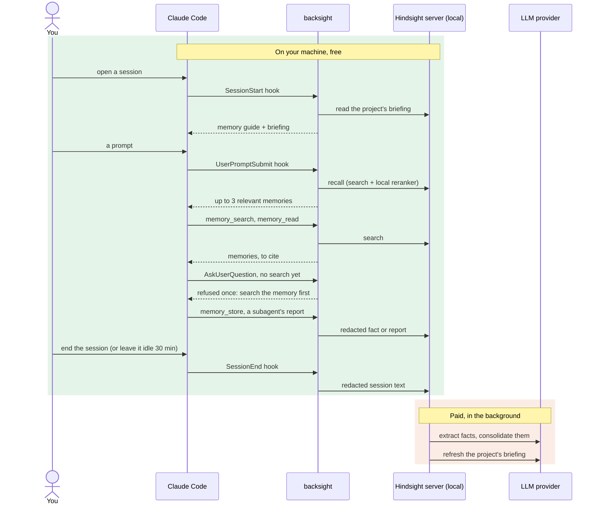
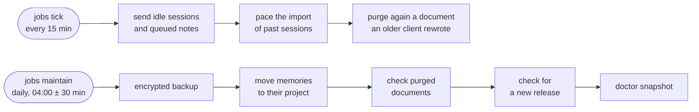

<h1>
  
  
</h1>

[](https://github.com/Barben360/backsight/actions/workflows/ci.yml?query=branch%3Amain)
[](https://github.com/Barben360/backsight/actions/workflows/gitleaks.yml?query=branch%3Amain)
[](https://github.com/Barben360/backsight/releases)
[](LICENSE)
[](go.mod)
[](docs/compatibility.md)
[](docs/compatibility.md)

Long-term memory for Claude Code, on a [Hindsight](https://github.com/vectorize-io/hindsight) server you run yourself.

- **What**: one Go binary that installs a memory server in Docker on your machine, wires it into Claude Code, and keeps it running.
- **Why**: Claude Code forgets everything between sessions. With backsight, Claude remembers what you decided, fixed and learned, across all your projects, and recalls it when it matters.
- **Cost**: searching the memory is local and free. Only turning sessions into memories uses an LLM: a few cents per session, paid to the provider you choose ([below](#what-it-costs)).

> A *backsight* is the surveying reading taken back on a known point before moving forward.

backsight is an independent project, not affiliated with or endorsed by Anthropic or Vectorize.

## Why backsight

I have used Claude Code for a long time, and what always wore on me was having to repeat myself: giving the same information again, correcting answers that left out part of the context. My only workaround was to spot what kept coming back and pin it down somewhere: the project's CLAUDE.md, my global CLAUDE.md, skills or plugins built for one project or for me. What I really needed was a memory: something that keeps what has already been said, doesn't fall into the same traps twice, and works the way I work.

I discovered agent memory with OpenClaw, but without the power of Claude Code. I found it again with LifeOS (formerly PAI), this time built into Claude Code. Not having to repeat things is a real comfort. But LifeOS installed a host of very invasive skills and principles, which changed completely from one update to the next, not always for the better, and rather opaquely. My setup no longer belonged to me.

I wanted a memory I would never have to act on again, and one that uses one of the real strengths of LLMs: semantic search. LifeOS and claude-mem both read a memory laid out in files, with slightly improved greps. With that, if I search for "authentication", the memory about an "expired token" doesn't come up, even though it was exactly the one I needed.

Looking for a system built on embeddings, with proven capabilities, auditable and easy to explore, I came across Hindsight. I liked its philosophy right away. I plugged it into Claude Code following its recommendations, imported months of memories into it, and was soon disappointed. The memories it injected, at session start as well as along the way, were not always relevant. Above all, each project had its own isolated bank: I felt like I was talking to a different person in each one.

So I experimented. Week after week, I measured the relevance of what was recalled, then adjusted accordingly: Hindsight's configuration, hooks to decide when Claude fetches information, skills to tell it how to search for it and bring it back into context. I kept what improved the measurements and threw out the rest. backsight grew out of these successive trials. Today I use it every day, both for my personal projects and at work, as two independent setups. For that use it beats everything I have tried, and I keep improving it on demanding ground: a large multi-project stack. Whether I start Claude in a project or in my home directory, I talk to the same person, who remembers what we are talking about, the decisions we made and the pitfalls already avoided. And I keep a clean Claude Code, with only the skills I need.

This memory layer is what I'm sharing here. First so you can benefit from it, but also so you can evaluate it, criticize it, suggest improvements, love it or hate it. And so that together we can make it what I hoped it would be.

## What it does for you

- **Remembers your sessions.** When a session ends, its text is redacted and sent to your server, which extracts durable facts: decisions, fixes, conventions, pitfalls.
- **Recalls at the right moment.** Each session starts with a briefing on the current project. Each prompt brings the few most relevant memories into Claude's context, and Claude searches the memory before answering factual questions. Every search runs on your machine, with no LLM call.
- **Stays yours.** The server runs on your machine, on `127.0.0.1`. You choose which LLM extracts the memories, and can pause or exclude anything.
- **Looks after itself.** Daily encrypted backups, signed updates that roll back on failure, and `backsight doctor` to say what is wrong and how to fix it.

New words (bank, observation, transverse…) are in the [glossary](docs/glossary.md).

## What Claude gets

Setup installs a Claude Code plugin, `backsight`, generated by the binary. Everything it adds to Claude:

| Kind | Name | What it brings |
|---|---|---|
| Hook | `SessionStart` | The memory guide (when to search and store, to report the memories used), the project's briefing, the status line; again after `/clear`, a resume or a compaction. |
| Hook | `UserPromptSubmit` | Up to 3 relevant memories added to the prompt, plus a reminder, a nudge to search, or a save prompt when one fits. |
| Hook | `PreToolUse` (`AskUserQuestion`) | The question gate: Claude searches the memory before asking you something it may already know. |
| Hook | `PostToolUse` (memory tools) | Notes that memory was searched, for the gate and the nudge; records which memories were shown and which Claude credited. |
| Hook | `PostToolUseFailure` | Off by default: when a tool call fails, the pitfalls memory knows about that failure. |
| Hook | `SubagentStart`, `SubagentStop` | A short memory guide and the top of the briefing for each subagent; its final report kept as a note; the same end-of-turn check as `Stop`. |
| Hook | `Stop`, `SessionEnd` | Marks the end of each reply (for the save detector); when memories were shown and Claude has not said which it used, asks it once to call `memory_credit`; sends the session to your server when it ends. |
| MCP tool | `memory_search` | Search the memory with 1 to 4 short queries, local and free. |
| MCP tool | `memory_read` | One memory with the facts it was built from. |
| MCP tool | `memory_store` | Store one durable fact, redacted, and see the 3 most similar memories. |
| MCP tool | `memory_credit` | Name the memories shown this session that informed the answer, or none; returns the citation line to print. Also reports a memory that proved wrong or outdated: the right fact is stored and the wrong memory retired, never deleted (`backsight forget --restore <id>` brings it back). |
| Skill | `/backsight:remember` | Store a fact you give it. |
| Skill | `/backsight:pause` | Stop or resume recording, for the session or the project. |
| Skill | `/backsight:memory-retro` | End-of-project retrospective: decisions, pitfalls, lessons into memory, corrections for stale ones. |
| Skill | `/backsight:memory` | The memory from the command line, when the MCP tools are missing or failing. |
| Skill | `/backsight:doctor` | Diagnose and fix backsight, and draft a bug report you confirm. |
| Permission | the four memory tools | Claude calls them without asking you each time. |

Each hook's time limit and exact behaviour: [how-it-works.md](docs/how-it-works.md#hooks).

## How it works

A session and the memory, step by step. The green part runs on your machine and costs nothing; only the orange part, in the background, calls your LLM provider.



Background jobs keep it running (systemd user timers):



Every hook, threshold and time limit: [how-it-works.md](docs/how-it-works.md).

## What it costs

backsight is free, and so is searching the memory: recall at each prompt, `memory_search` and `backsight search` run on your machine, with the server's local search models, and send nothing out. The server's LLM is not free: it reads each session to extract memories, and you pay its provider for the tokens.

| Provider | Per session | Per month (5 sessions a day, 22 days) |
|---|---|---|
| DeepSeek V4.1 Flash (default) | $0.05, $0.10 at peak hours | $5, up to $11 |
| Claude Haiku 5.5 | $0.04 | $4 |
| GPT-6 Luna | $0.04 | $4 |
| Ollama on your machine | free, but slow on a CPU and lower quality | free |
| Your Claude subscription | counts against your plan; [not recommended](docs/privacy.md#the-claude-subscription-lane) | |

How these figures are made, so you can redo them for your use:

- **A session** is 30,000 characters of sent text (your prompts, Claude's replies and one line per tool call): the average of 42 real sessions of the author.
- **Tokens per session**, from backsight's own estimate (the one `backsight retain backfill --plan` shows): about 92,000 input and 14,000 output tokens for extraction and consolidation. Output is counted 2.5 times over for the model's thinking tokens, the ratio measured on the author's server. Add one refresh of the project's briefing, about 96,000 input tokens.
- **Prices**, per million tokens: DeepSeek V4.1 Flash $0.15 input and $0.60 output off-peak, twice that at peak hours (01:00–04:00 and 06:00–10:00 UTC on weekdays, [DeepSeek pricing](https://api-docs.deepseek.com/quick_start/pricing/)); Claude Haiku 5.5 $0.10 input and $0.50 output ([Claude pricing](https://claude.com/pricing)); GPT-6 Luna $0.10 input and $0.50 output ([OpenAI pricing](https://developers.openai.com/api/docs/pricing)). Checked on 2026-10-26, GPT-6 Luna on 2026-10-27. Cached input, which is cheaper, is counted at the full price.
- **In setup**, the providers are `deepseek` (model `deepseek-flash`, not the Pro model), `anthropic`, `openai`, `ollama` and `claude-code`. GPT-6 Luna (`gpt-6-luna`) is the default model for `openai`.

Long sessions cost more, short ones less. Importing your past sessions (backfill) is a one-off at about the same price per session: setup shows its estimate and a spending cap before you accept. `backsight stats` shows the tokens actually spent, and their cost once the model's price is known ([configuration.md](docs/configuration.md#llm-the-model-that-extracts-memories)).

Your Claude Code usage does not change, except that memories take a little of Claude's context: at most 3,000 to 4,000 tokens per session ([how-it-works.md](docs/how-it-works.md#time-and-context-it-costs)).

## Before you start

You need:

1. **Linux** on amd64. macOS and Windows come later.
2. **Docker with Compose v2**, usable without `sudo`:
   - install Docker Engine for your distribution: [docs.docker.com/engine/install](https://docs.docker.com/engine/install/);
   - add yourself to the `docker` group, then log out and back in: `sudo usermod -aG docker $USER` ([details](https://docs.docker.com/engine/install/linux-postinstall/)). Members of this group have root-level access to the machine; [rootless Docker](https://docs.docker.com/engine/security/rootless/) avoids that and works too;
   - check: `docker compose version` prints a version 2, without `sudo`.
3. **Claude Code** 2.1.309 or newer, with `claude` on your PATH: [install Claude Code](https://code.claude.com/docs/en/setup).
4. **An API key for the LLM that extracts memories**, from a pay-as-you-go account (a Claude subscription is not one):
   - DeepSeek: [platform.deepseek.com/api_keys](https://platform.deepseek.com/api_keys), then top up a few dollars. DeepSeek stores data in the People's Republic of China: read [privacy.md](docs/privacy.md#your-llm-provider) first;
   - Anthropic: [platform.claude.com/settings/keys](https://platform.claude.com/settings/keys);
   - OpenAI: [platform.openai.com/api-keys](https://platform.openai.com/api-keys);
   - or no key at all, with [Ollama](https://ollama.com/download) running on the machine.
5. About **6 GB of free disk** (the server image and its models are about 2.3 GB to download), and `curl`.

## Install

**Let your coding agent install it.** Paste this into Claude Code or any coding agent:

```text
Install Backsight for me by following https://raw.githubusercontent.com/Barben360/backsight/main/docs/agent-guide.md — ask me before every choice.
```

The agent never sees your LLM key: you type it yourself. Or install by hand:

1. Install the binary. The script checks the release's signature and checksum before installing anything:

   ```sh
   curl -fsSL https://raw.githubusercontent.com/Barben360/backsight/main/scripts/install.sh | sh
   ```

   If it prints an `export PATH=…` line, run it (or open a new login shell).

2. Set it up:

   ```sh
   backsight setup
   ```

   Setup checks the machine, asks a few questions (the LLM provider, how long Claude Code keeps transcripts, backups, importing past sessions), shows its plan and asks for your consent. It then asks for your provider key at a hidden prompt: keys are never passed as arguments. The first run downloads the server: several minutes on a home connection. If setup stops, fix what it says and run `backsight setup --resume`; [troubleshooting.md](docs/troubleshooting.md#setup-stopped) covers the usual causes.

3. Restart Claude Code (or run `/reload-plugins` in it).

Every detail: [docs/install.md](docs/install.md).

## Check it works

1. `backsight verify` runs every hook and the memory tools as Claude Code does, then stores and recalls a test memory. No line should say `fail`.
2. Start a Claude Code session in one of your projects. Its first line is `🧠 backsight · 🗂️ <project>`; the very first session also shows `👋 Memory is on`, with where sessions go.
3. `backsight doctor` checks the whole install. Right after setup, a warning that there is no backup yet is expected: the first one runs tonight, or now with `backsight backup create`.
4. Work as usual. Once your first session has ended (or sat idle for 30 minutes) and a few minutes more have passed, `backsight verify --live` confirms it reached the server and became memories, and `backsight search "<a topic of that session>"` finds them.

When Claude uses a memory, it cites it:

> 🧠 **From memory (my-project · 0b4c2a52)** — the API client retries 3 times, decided on 2026-10-12 because the gateway drops idle connections.

## Pause, turn off, uninstall

| To | Run | What stays |
|---|---|---|
| Stop recording this session | `/backsight:pause` in Claude Code (`/backsight:pause resume` to go on) | Recall keeps working. |
| Never record a project | `backsight pause --project` in its directory | Recall keeps working there. |
| Undo setup | `backsight setup --undo` | backsight, your config and your memory; Claude Code is as before. |
| Remove backsight | `backsight uninstall` | Your memory server and backups. |
| Remove everything | `backsight uninstall --delete-data --purge-local` | Your backups, and the Docker images ([uninstall.md](docs/uninstall.md)). |

## Example

Monday, in a session on your `billing` project:

```text
> The invoices job times out against the new gateway. Let's raise the client timeout to 60 s and retry twice.
```

The session ends; backsight sends it to your server, which extracts the decision. On Thursday, in a new session:

```text
> Why does the invoices job take so long on failures?
```

backsight adds the memory to your prompt, and Claude answers with it:

> 🧠 **From memory (billing · 7d1e93a0)** — the invoices client timeout was raised to 60 s with 2 retries on 2026-10-12, because the new gateway is slow to answer.
>
> A failing call can take up to 3 minutes: 60 s for each of the 3 attempts.

## Privacy

- The server runs locally, on loopback, with its API and web UI behind keys. Recall and searches never leave the machine.
- Session text goes to the LLM provider you chose, under that provider's terms. With Ollama, it stays on the machine.
- The server downloads its two search models from Hugging Face on its first start, and Docker pulls its images; no memory text goes with them.
- Secrets are redacted before anything is stored, facts that look like secrets are refused, and Claude is told never to ask you for a key in the conversation.
- `/backsight:pause` stops recording a session; `backsight pause --project` or a `.backsight.toml` with `retain = false` excludes a project.
- Backups are always encrypted.
- No telemetry, no automatic reports. The binary's only other connection is a daily check for new releases on GitHub.

Details, with each provider's terms and where it keeps data: [docs/privacy.md](docs/privacy.md).

## Daily use

You mostly use Claude Code as before. Commands you may need:

| Command | Use |
|---|---|
| `backsight doctor` | Check everything, with a fix for each problem (in Claude Code: `/backsight:doctor`, which can also file a bug). |
| `backsight search "<keywords>"` | Search the memory yourself (local, free). |
| `backsight store --kind decision "<fact>"` | Store a fact (in Claude Code: `/backsight:remember`). |
| `backsight forget <id>` | Retire a wrong memory. |
| `backsight pause` / `backsight resume` | Stop or restart recording (in Claude Code: `/backsight:pause`). |
| `backsight stats` | See how memory was used this week, and what it cost. |
| `backsight update apply` | Install a newer release, after checking its signature; you are told when one is out. |

## Documentation

`backsight guide` browses these docs in the terminal, and `backsight guide search "<question>"` searches them.

| Page | What is in it |
|---|---|
| [install](docs/install.md) | Requirements, setup questions, secrets, where files go. |
| [daily use](docs/daily-use.md) | Sessions, projects, skills, searching, storing, forgetting. |
| [how it works](docs/how-it-works.md) | Recall, the question gate, the save detector, latency and context cost, the hooks. |
| [configuration](docs/configuration.md) | Every `config.toml` key. |
| [privacy](docs/privacy.md) | What is stored, what leaves the machine, each provider's terms. |
| [commands](docs/commands.md) | Every command and flag. |
| [backups and restore](docs/backups-and-restore.md), [update](docs/update.md), [uninstall](docs/uninstall.md) | Keeping the install safe and current. |
| [troubleshooting](docs/troubleshooting.md) | When setup or memory stops working. |
| [glossary](docs/glossary.md) | The words these docs use. |

## Status

backsight is a **preview**: it runs daily on its author's machine, but expect rough edges and changes between releases. Linux is the only tested platform. Each release pins one Hindsight version, listed in [docs/compatibility.md](docs/compatibility.md).

Found a problem? Ask Claude `/backsight:doctor`: it diagnoses, fixes with your OK, and drafts the issue it files only once you confirm. Or run `backsight report` yourself: it prints a redacted diagnostic and a link to file a GitHub issue, and sends nothing itself. For a security problem, see [SECURITY.md](SECURITY.md).

Contributing: [CONTRIBUTING.md](CONTRIBUTING.md).

## Third-party components

backsight does not ship these: Docker pulls the images from their publishers, and the server downloads the models from Hugging Face. They come under their own licences and terms, which you accept by installing them: check them against your use, at work in particular.

| Component | Licence | Notes |
|---|---|---|
| [Hindsight](https://github.com/vectorize-io/hindsight) server image, by Vectorize | [MIT](https://github.com/vectorize-io/hindsight/blob/main/LICENSE) | The memory server. |
| [pgvector](https://github.com/pgvector/pgvector) image (PostgreSQL with pgvector) | [PostgreSQL License](https://github.com/pgvector/pgvector/blob/master/LICENSE) | The server's database. |
| [multilingual-e5-small](https://huggingface.co/intfloat/multilingual-e5-small), the embedding model | MIT | Downloaded at the server's first start. |
| [mmarco-mMiniLMv2-L12-H384-v1](https://huggingface.co/cross-encoder/mmarco-mMiniLMv2-L12-H384-v1), the reranker | Apache-2.0 | Downloaded at the server's first start. It was trained on mMARCO, a translation of [MS MARCO](https://microsoft.github.io/msmarco/), whose terms say the data is "intended for non-commercial research purposes only". Whether those terms reach a model trained on it is unsettled; Hindsight's own default reranker has the same origin. If it matters for your use, run another reranker ([troubleshooting.md](docs/troubleshooting.md#slow-recall-and-gpu-acceleration) shows how). |
| [Qwen3 8B](https://huggingface.co/Qwen/Qwen3-8B), only with the `ollama` provider | Apache-2.0 | You pull it with Ollama. |
| Go modules compiled into the binary | MIT, BSD-3-Clause, Apache-2.0 | Listed in [go.mod](go.mod). Their license texts and notices, with the Go standard library's, ship as `THIRD_PARTY_LICENSES` in every release archive and print with `backsight version --licenses`. |

Your LLM provider's terms apply to what the server sends it: [privacy.md](docs/privacy.md#your-llm-provider).

## License

MIT, see [LICENSE](LICENSE).
